# J.A.R.V.I.S. — a personal voice assistant with memory

[](https://github.com/Zeus-coding/jarvis/actions/workflows/ci.yml)


An Iron Man–style voice assistant that runs on your own computer and lives in the browser — on desktop and as an installable app on your phone. You wake it with your voice, it reasons with a large language model (Google Gemini by default), answers with a natural voice, knows your calendar, remembers what matters to you, takes lecture notes in real time and helps you review your day.

> **Lingua**: l'interfaccia e l'assistente parlano italiano. *Italian summary at the bottom.*

## Highlights

| | |
|---|---|
| 🎙️ **Hands-free voice loop** | Wake word, streaming answers spoken sentence by sentence, echo guard while speaking, barge-in with "stop", turn-taking that waits for real pauses instead of cutting you off. |
| 🧠 **Long-term memory** | Profile + core facts always in context, semantic recall over past facts and "diary" summaries of old conversations (embeddings + cosine similarity), shared between devices. |
| 🛠️ **Tool use** | The model calls functions: calendar events, tasks, memories, web search, weather, WhatsApp messages and phone calls, daily reviews. |
| 🗓️ **My Day** | Dashboard with an AI-written summary, weather, agenda, tasks, evening review (AI draft) and weekly review with an action plan. |
| 🎓 **Lecture mode** | On the phone: live speech transcription + rear-camera snapshots of the board when it changes; Gemini keeps structured notes (headings, tables, charts) updated in real time; final summary, likely exam questions, Word export. |
| 📱 **Installable PWA** | Home-screen app, service worker, **Web Push** notifications (event reminders, evening review), secure remote access through a Cloudflare tunnel with QR code. |
| 🔒 **Privacy & security by design** | Keys and data never leave your machine except for what the model needs; password-protected remote access (scrypt hashes, HttpOnly SameSite cookies, rate limiting, CSRF origin checks); contacts' phone numbers are never sent to the AI. |

## Architecture

```mermaid
flowchart LR
  subgraph Browser["Browser / installable app"]
    UI["Voice HUD<br/>three.js orb"] --- Day["My Day"]
    UI --- Lesson["Lecture mode"]
    SW["Service worker<br/>Web Push"]
  end
  subgraph Server["Node.js server (your computer)"]
    API["HTTP API + auth"] --> Brain["Brain loop<br/>(tools, streaming)"]
    Brain --> Mem["Memory<br/>embeddings"]
    Brain --> Agenda["Agenda<br/>iCal parser"]
    API --> Sched["Scheduler"] --> Push["Web Push"]
    API --> TTS["TTS cache"]
  end
  UI <-- "SSE stream" --> API
  Brain <--> Gemini["Google Gemini<br/>(or OpenAI)"]
  TTS <--> Voice["Python voice service<br/>edge-tts · Whisper"]
  Push --> SW
  Phone["Phone"] -- "HTTPS tunnel<br/>(Cloudflare)" --> API
```



- **Frontend** (`public/`): vanilla ES modules, no build step. `app.js` is a small state machine (`sleep → wake → listen → think → speak`) that drives the 3D scene (`orb.js`, custom GLSL shader + bloom), the audio engine (`voice.js`: Web Audio, Web Speech API, VAD fallback) and the panels.
- **Backend** (`server.mjs` + `src/`): dependency-light Node.js (only `three`, `web-push`, `qrcode-generator`). The brain module runs the tool-calling loop over Server-Sent Events, picks the best available Gemini model automatically, handles reasoning-budget differences between models and falls back gracefully on free-tier limits.
- **Data**: a single JSON store written atomically (temp file + rename) in `data/`, excluded from git.
- **Voice**: ElevenLabs → free neural voice (Python, edge-tts) → browser speech synthesis, with an on-disk cache and an automatic circuit breaker when a provider is slow.

## Getting started

Requirements: **Node.js 22+**; Python 3.9+ is optional (free neural voice).

```bash
npm run setup     # installs dependencies and the free voice
npm start         # → http://localhost:4173 (Chrome or Edge)
```

On first launch the page asks for a **Google Gemini API key** (free tier, [Google AI Studio](https://aistudio.google.com/apikey)). Everything else — voice, calendar link, profile, phone access, contacts — is optional and lives in the CONFIGURA panel.

**Phone**: install [cloudflared](https://developers.cloudflare.com/cloudflare-one/connections/connect-networks/downloads/), set a password and enable "Indirizzo per il telefono" in CONFIGURA, then scan the QR code. From the phone browser choose *Add to Home screen* to install the app and enable notifications.

## Testing

```bash
npm test          # 32 unit tests (node:test) — iCal recurrences and time zones, vCard import,
                  # safe Markdown rendering, password hashing, tasks, reviews, scheduler
npm run check     # syntax check of every JS file
```

GitHub Actions runs both on Node 22 and 24 and smoke-tests the server start on every push.

## Project structure

```
server.mjs            HTTP entry point (auth gate, routing, static files)
src/                  brain, gemini, tools, memory, dialog, agenda, tasks, reviews, day,
                      push, scheduler, lessons, contacts, tts, voice-service, tunnel, auth…
calendar.mjs          iCalendar reader (RFC 5545 subset: TZID, RRULE, EXDATE, RECURRENCE-ID)
voice_service.py      local voice service (edge-tts, optional faster-whisper)
public/               voice HUD, My Day, lecture mode, PWA files
test/                 unit tests
```

## Credits

The idea of a browser-based JARVIS came from a demo project shared on TikTok ("jarvis-tiktok"). This repository is an independent rewrite: the 3D scene, interface, audio engine, server modules, calendar parser and voice service were written from scratch, and memory, lecture mode, My Day, reviews, notifications, phone access and contacts are new features.

Built with the help of AI coding assistants (Claude Code), which I used as a pair programmer for design, implementation and tests. Libraries: [three.js](https://threejs.org) (MIT), [web-push](https://github.com/web-push-libs/web-push) (MPL-2.0), [qrcode-generator](https://github.com/kazuhikoarase/qrcode-generator) (MIT), [edge-tts](https://github.com/rany2/edge-tts) (LGPL-3.0), [faster-whisper](https://github.com/SYSTRAN/faster-whisper) (MIT); font Inter (SIL OFL). Released under the [MIT License](LICENSE).

---

### In italiano

Jarvis è un assistente vocale personale che gira sul tuo computer: lo svegli con «Ciao Jarvis», ragiona con Google Gemini (piano gratuito), ti risponde con una voce naturale, conosce la tua agenda e si ricorda di te. Dal telefono funziona come app installabile, con notifiche, modalità lezione (appunti in tempo reale dalla voce del professore e dalle foto della lavagna), pagina «La mia giornata» e revisione serale e settimanale.

Installazione: `npm run setup`, poi `npm start` e apri http://localhost:4173. Istruzioni complete in [AGENTS.md](AGENTS.md).
